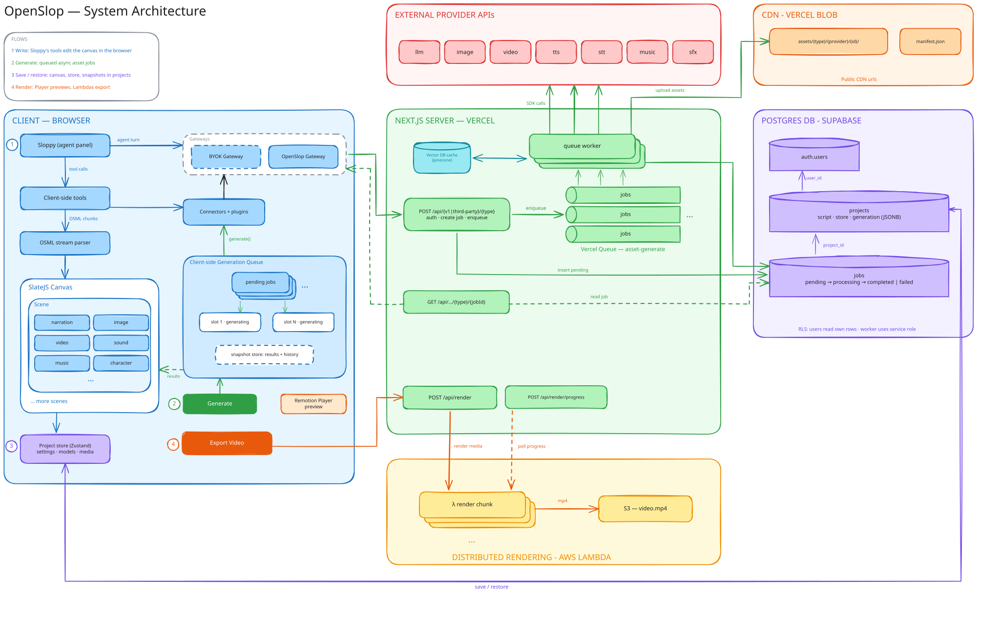
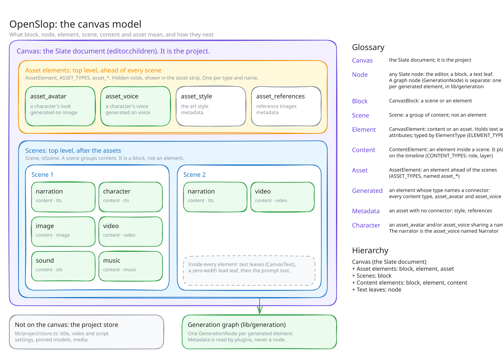

# Architecture

OpenSlop aims to be an expert generative AI agent that combines any models, from video, image and voice to music, sound and 3D, into whatever the user imagines, from a single shot to a film, a podcast or an explainer.

> The diagrams are Excalidraw files in [`docs/`](./docs). Edit one at [excalidraw.com](https://excalidraw.com), then re-export its SVG.

The project lives in the browser as one document. The server stays thin: it proxies models, runs generation jobs, renders and saves.

## Flows

The numbers match the diagram.

1. **Write.** Sloppy, or the user, writes the script into the canvas.
2. **Generate.** The client queues stale elements; the server runs each as a job and stores the result in Vercel Blob.
3. **Save.** The canvas, project store and snapshots save to one `projects` row, with autosaved history in `canvas_versions`.
4. **Render.** The canvas and its results lay out into one Remotion timeline. The Player previews it in the browser; Lambdas render it in parallel chunks to an MP4 in S3.

## Canvas and generation

- **Canvas** (`lib/canvas/`): the Slate document, and the project itself. It saves as OSML, a tag format the LLM writes too, so Sloppy and the user edit the same thing.
- **Element**: one block on the canvas, with prompt text and attributes. Its type is declared once in `ELEMENT_TYPES`.
- **Asset element**: an element ahead of the scenes, named `asset_*`: a character's avatar and voice, the art style, the references. It is known by its type and name, and content uses it by reference, so a character looks and sounds the same everywhere.
- **Scene**: an ordered group of content elements.
- **Content element**: an element inside a scene that plays on the timeline: narration, character dialogue, image, video, sound, music.
- **Generation attributes** shape what a model makes (model, duration, voice). **Layout attributes** shape how a result plays (volume, loop, trim, motion). Layout attributes never make an element stale, so editing the layout never costs a regeneration.

Generation is a dependency graph built from the canvas (`lib/generation/`):

- **Connector** (`lib/connectors/`): turns an element into a generation request, one per media type (LLM, image, video, TTS, voice, STT, music, sound).
- **Plugins** (`lib/connectors/registry.ts`): per-type behaviour (extra dependencies, metadata reads, prompt hooks) added to the graph instead of special cases in it.
- **Graph node**: one per generated element, holding its inputs and edges to the elements it uses, so a video depends on its character's avatar. A node is stale when it has no result, a dependency regenerated, or its inputs changed.
- **Queue** (`GenerationQueue`): runs stale nodes, dependencies first, with a concurrency limit per media type. It rebuilds each node from the live canvas when its job starts, so it never generates from an old prompt.
- **Snapshot store** (`SnapshotStore`): each element's generation state and the results it has had, keyed by element id. It lives apart from the canvas so typing never churns results and results never rewrite the script. Any past result can be restored from the element's history.

## Project store and media

- **Project store** (`lib/project/`): a Zustand store for what is not on the canvas: the title, video and script settings, pinned models and media. It owns saving and version history.
- **Media**: the project's own files, apart from the canvas. Uploads land there through `useMediaUpload`. Every take generated in the Media panel lands there too, via `useAddDraftTakesToMedia`. An item is named after its file, or its type for a take, and removing one never touches the elements that use its URL.

## Sloppy

Sloppy is the agent in the editor's left panel, with a client-side harness:

- The server (`lib/api/agent-turn.ts`) streams the model's text and tool calls. Its tools have specs but no executors.
- The browser runs each tool (`lib/agent/tools/`) against the canvas and the project store, then posts the result back, until the model answers in text.

So Sloppy works through the same canvas, queue and stores as the user, sees edits as they happen, and the client stays the one writer of the project. A new skill is a new tool in `lib/agent/tools/registry.ts`, not a new pipeline.

## Layout and render

- **Layout** (`lib/render/`): resolves the canvas and its snapshots into a timeline: scene lengths from the speech, visuals spanned across them, transitions, captions. It is the one length model, shared by the preview, the render and Sloppy's estimates.
- **Remotion** (`remotion/`): one composition draws that timeline as React. The Player previews it in the editor; Lambda renders it for export, so the preview is the export.

## Models and keys

- **Model**: a `{ provider, model }` pair, listed in `MODELS` (`lib/connectors/models.ts`). Each element stores its own; defaults resolve element, then project, then account.
- **Gateway** (`lib/gateway/`): the HTTP client from a connector to our routes. `/api/v1` serves models OpenSlop hosts; `/api/third-party` serves models a user brings a key for.
- **Provider** (`lib/providers/`): the server-side vendor adapter, shared by both route families.
- **Job**: an asset route records a `jobs` row and hands it to a Vercel Queue worker, which calls the provider and uploads the result to Vercel Blob. The client polls the job until it settles.
- **Provider key**: a user's key for a vendor, kept in Supabase Vault, read by the service role only for the request that uses it, and never sent to a client.

`proxy.ts` refreshes the Supabase session; `withSession` and `withApiAccess` guard the routes.

## Data

Supabase Postgres with row-level security. Generated files live in Vercel Blob.

| Table                          | Holds                                              |
| ------------------------------ | -------------------------------------------------- |
| `projects`                     | The canvas (as OSML), project store and snapshots  |
| `canvas_versions`              | Autosaved history of those columns                 |
| `jobs`                         | Generation jobs, their status and what they cost   |
| `provider_keys`                | One row per user and provider: vault id, last four |
| `conversations` and `messages` | One Sloppy conversation per project, and its turns |

## Adding things

- **Hosted model:** a row in its type's `openslop/models.ts` and in `lib/api/providers/openslop.ts`.
- **BYOK provider:** a provider catalog entry, a models map under `lib/connectors/<type>/<provider>/`, and a vendor class per type with `validate()`.
- **Media type:** a connector, a provider, a models map, a row in `lib/api/asset-routes.ts`, and two route files.
- **Per-type generation behaviour:** a plugin in `lib/connectors/registry.ts`.
- **Sloppy tool:** a `defineTool` in `lib/agent/tools/`, added to the registry.
