  
  

<b>Le studio de production IA open source.</b> Discutez et obtenez des films, séries, livres audio, clips musicaux, documentaires, drames et bien plus, prêts à publier.

  
  
  
  
  
  
  
  
  
  

  <a href="../../README.md">English</a> · <a href="README.zh-CN.md">中文</a> · <a href="README.ja.md">日本語</a> · <a href="README.ko.md">한국어</a> · <a href="README.es.md">Español</a> · Français · <a href="README.pt.md">Português</a>

  <a href="https://openslop.ai"><b>openslop.ai</b></a>
  &nbsp;·&nbsp;
  <a href="https://app.openslop.ai">app.openslop.ai</a>

  

---

> **Bêta privée.** Sur invitation uniquement pour le moment.
> [Inscrivez-vous sur la liste d'attente sur openslop.ai](https://openslop.ai), ou [utilisez le mode local](local-mode.fr.md) pour le lancer dès aujourd'hui sur votre ordinateur.

## Aperçu

OpenSlop relie tous vos outils IA préférés dans un seul flux de travail pour que vous puissiez faire de belles vidéos en quelques minutes, sans plus jongler entre dix onglets. Vous apportez vos comptes IA, OpenSlop apporte le flux de travail. C'est tout.

Ça tourne dans votre navigateur, rien à installer. Open source, gratuit pour toujours. Construit par des ingénieurs venus de Meta, Google, Stripe et Dropbox.

## Démarrer

Vous pouvez utiliser OpenSlop de deux façons :

- **En ligne** sur [app.openslop.ai](https://app.openslop.ai). Rien à installer. C'est sur invitation pour l'instant, alors [inscrivez-vous sur la liste d'attente](https://openslop.ai).
- **Mode local** sur votre propre ordinateur. [Suivez le guide d'installation →](local-mode.fr.md)

Vous travaillez sur le code ? Préparez un environnement de développement avec [CONTRIBUTING.md](../../CONTRIBUTING.md#setup).

## Fonctionnalités

<table>
<tr>
<td width="50%" valign="middle">

### Décrivez votre vidéo

Tapez une ligne. Choisissez 16:9 ou 9:16, une langue, un modèle et une durée, ou collez un script que vous avez déjà. Sept modèles sont là si vous avez besoin d'un coup de pouce.

[Le composeur →](../../app/components/copilot/composer-copilot.tsx)

</td>
<td width="50%">
  
</td>
</tr>
<tr>
<td width="50%" valign="middle">

### Sloppy l'écrit avec vous

Le copilote vit dans le panneau de gauche. Il lit le script, structure l'histoire, écrit les scènes et ajuste les cartes vidéo au dialogue. Tout ce qu'il fait atterrit sur le canevas sous vos yeux.

[Comment un tour fonctionne →](../../ARCHITECTURE.md#sloppy)

</td>
<td width="50%">
  
</td>
</tr>
<tr>
<td width="50%" valign="middle">

### Un storyboard, pas une zone de prompt

Chaque scène est une pile de cartes : voix, image, vidéo, son, musique. Modifiez n'importe quel prompt, choisissez un modèle par carte, glissez pour réordonner, et insérez là où vous survolez.

[Le modèle de document →](../../lib/canvas)

</td>
<td width="50%">
  
</td>
</tr>
<tr>
<td width="50%" valign="middle">

### Un clic génère tout

Generate all (tout générer) met chaque élément en file d'attente et lance d'abord les dépendances : la carte vidéo dont une scène continue avant la scène elle-même, un avatar avant l'image où il apparaît. Changez un prompt plus tard et la carte affiche **Stale** (obsolète) et pourquoi.

[Le graphe de génération →](../../ARCHITECTURE.md#canvas-and-generation)

</td>
<td width="50%">
  
</td>
</tr>
<tr>
<td width="50%" valign="middle">

### Lecteur et timeline

Regardez le montage se remplir, sous-titres mot par mot. Quatre pistes en dessous : visuels, voix, effets, musique. Parcourez la règle, sautez de scène en scène, ou passez à la bande storyboard.

[Le lecteur →](../../app/components/player)

</td>
<td width="50%">
  
</td>
</tr>
<tr>
<td width="50%" valign="middle">

### Apportez vos propres clés

Les modèles hébergés viennent avec votre compte. Collez une clé Anthropic, Runware, Cartesia ou ElevenLabs et leurs modèles apparaissent dans chaque sélecteur. Les clés vivent dans Supabase Vault et n'atteignent jamais le navigateur.

[Modèles et clés de fournisseurs →](../../ARCHITECTURE.md#models-and-keys)

</td>
<td width="50%">
  
</td>
</tr>
<tr>
<td width="50%" valign="middle">

### Lancez-le sur votre ordinateur

Utilisez OpenSlop sur votre propre Mac, PC Windows ou Linux. Vos projets et vos vidéos restent chez vous.

[Mode local →](local-mode.fr.md)

</td>
<td width="50%">
  
</td>
</tr>
</table>

**Aussi dans la boîte :**

- **[Sous-titres](../../app/components/canvas/panel/captions-panel.tsx)** — Six préréglages, douze polices, apparition mot par mot ou ligne par ligne, et chaque couleur, bordure et placement est à vous de changer.
- **[Export jusqu'en 4K](../../app/components/player/export-button.tsx)** — Rend sur Remotion Lambda en morceaux parallèles et vous livre un MP4.
- **[Historique des versions](../../app/components/canvas/panel/canvas-history-panel.tsx)** — Sauvegarde automatique pendant que vous travaillez, regroupée en points de contrôle. Consultez n'importe quelle version et restaurez-la.
- **[Personnages et style graphique](../../app/components/canvas/elements/asset-strip.tsx)** — Nommez un personnage une fois et chaque image, réplique et avatar reste cohérent.
- **[Modèles](../../lib/templates/templates.ts)** — POV Life, Sleep Story, True Crime, et plus. Chacun amorce un style, ses personnages et une durée.
- **[Mocks pour le développement](../../.env.example)** — Laissez une clé de fournisseur vide et ses appels retombent sur des résultats préenregistrés, pour que vous puissiez développer sans payer.

## Stack technique

| Couche     | Techno                                                                                                       |
| ---------- | ------------------------------------------------------------------------------------------------------------ |
| Framework  | [Next.js 16](https://nextjs.org) (App Router)                                                                |
| Langage    | [TypeScript 5](https://www.typescriptlang.org)                                                               |
| UI         | [React 19](https://react.dev), [Tailwind CSS 4](https://tailwindcss.com), [shadcn/ui](https://ui.shadcn.com) |
| Auth + BDD | [Supabase](https://supabase.com) (Auth, Postgres, RLS)                                                       |
| Vidéo      | [Remotion 4](https://remotion.dev) (composition, rendu, lecteur)                                             |
| Stockage   | [Vercel Blob](https://vercel.com/docs/storage/vercel-blob) (stockage des ressources générées)                |
| Icônes     | Jeu maison de SVG masqués (`components/ui/icon.tsx` + `components/ui/icons/`), aucune dépendance d'icônes    |

## Structure du projet

L'organisation du code et la façon dont ses couches s'articulent : [`ARCHITECTURE.md`](../../ARCHITECTURE.md#project-structure).

## Scripts

| Commande                  | Ce qu'elle fait                     |
| ------------------------- | ----------------------------------- |
| `npm run dev`             | Démarre le serveur de développement |
| `npm run local`           | Lance le mode local                 |
| `npm run build`           | Build de production                 |
| `npm run lint`            | ESLint                              |
| `npm run format:check`    | Vérification Prettier               |
| `npm run typecheck`       | Vérification TypeScript             |
| `npm run knip`            | Vérification du code mort           |
| `npm run test:run`        | Lance les tests une fois (Vitest)   |
| `npm run test:e2e`        | Tests de fumée (Playwright)         |
| `npm run db:push`         | Pousse les migrations vers Supabase |
| `npm run remotion:studio` | Ouvre Remotion Studio               |

## Contribuer

Les contributions sont les bienvenues. Voir [`CONTRIBUTING.md`](../../CONTRIBUTING.md) pour l'installation, la séquence de vérifications, et ce que nous attendons d'une PR.

## Communauté

  

Des questions, des idées, ou juste envie de passer ? [Rejoignez notre Discord](https://discord.gg/zeP5482ced) ou [écrivez-nous](mailto:hi@openslop.ai).

Tout le monde dans la communauté est tenu de suivre notre [Code de conduite](../../CODE_OF_CONDUCT.md). Pour signaler un problème, écrivez à [hi@openslop.ai](mailto:hi@openslop.ai).

## Historique des étoiles

  
  

## Licence

Sous [licence Apache 2.0](../../LICENSE).
