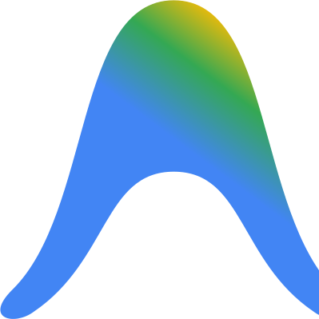
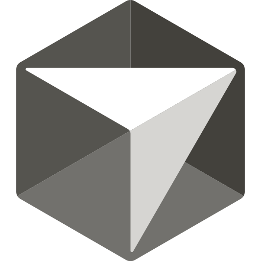
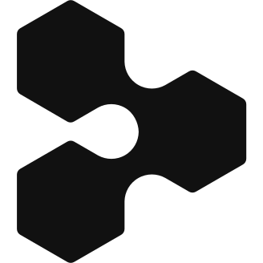

  
  

<b>オープンソースの AI 制作スタジオ。</b> チャットするだけで、映画、シリーズ、オーディオブック、ミュージックビデオ、ドキュメンタリー、ドラマなどが完成。

  
  
  
  
  
  
  
  
  
  

  <a href="../../README.md">English</a> · <a href="README.zh-CN.md">中文</a> · 日本語 · <a href="README.ko.md">한국어</a> · <a href="README.es.md">Español</a> · <a href="README.fr.md">Français</a> · <a href="README.pt.md">Português</a>

  <a href="https://openslop.ai"><b>openslop.ai</b></a>
  &nbsp;·&nbsp;
  <a href="https://app.openslop.ai">app.openslop.ai</a>

  

---

> **プライベートベータ。** 今は招待制です。
> [openslop.ai でウェイトリストに登録](https://openslop.ai)するか、[ローカルモード](local-mode.ja.md)で今日から自分のパソコンで使えます。

## 概要

OpenSlop は、お気に入りの AI ツールをすべてひとつのワークフローにつなぎます。10個のタブを行き来しなくても、数分で見栄えのいい動画が作れます。あなたは AI アカウントを持ち寄り、OpenSlop はワークフローを持ち寄る。それだけです。

ブラウザで動くので、インストールするものはありません。オープンソースで、ずっと無料。Meta、Google、Stripe、Dropbox 出身のエンジニアが作っています。

## はじめ方

OpenSlop の使い方は 2 つあります。

- **オンライン**：[app.openslop.ai](https://app.openslop.ai) で使えます。インストールは不要です。今は招待制なので、[ウェイトリストに登録](https://openslop.ai)してください。
- **ローカルモード**：自分のパソコンで動かします。[セットアップガイドを見る →](local-mode.ja.md)

コードに手を入れるなら、[CONTRIBUTING.md](../../CONTRIBUTING.md#setup) で開発環境を用意してください。

## 機能

<table>
<tr>
<td width="50%" valign="middle">

### 動画を説明する

一行だけ打ちます。16:9 か 9:16、言語、モデル、長さを選ぶか、すでにある台本を貼り付けます。ひと押しほしいときは、7つのテンプレートがあります。

[コンポーザー →](../../app/components/copilot/composer-copilot.tsx)

</td>
<td width="50%">
  
</td>
</tr>
<tr>
<td width="50%" valign="middle">

### Sloppy が一緒に書く

コパイロットは左のパネルにいます。台本を読み、話の骨組みを作り、シーンを書き、動画カードをセリフに合わせます。やったことはすべて、見ている間にキャンバスに現れます。

[ターンの仕組み →](../../ARCHITECTURE.md#sloppy)

</td>
<td width="50%">
  
</td>
</tr>
<tr>
<td width="50%" valign="middle">

### プロンプト欄ではなく、ストーリーボード

どのシーンもカードの束です: 音声、画像、動画、効果音、音楽。どのプロンプトも編集でき、カードごとにモデルを選び、ドラッグで並べ替え、ホバーした場所に挿入できます。

[ドキュメントモデル →](../../lib/canvas)

</td>
<td width="50%">
  
</td>
</tr>
<tr>
<td width="50%" valign="middle">

### ワンクリックですべて生成

Generate all（すべて生成）は、すべての要素をキューに入れ、依存するものを先に走らせます: シーンが続きとして使う動画カードをそのシーンの前に、それが登場する画像の前にアバターを。あとでプロンプトを変えると、カードが **Stale**（古い）と、その理由を示します。

[生成グラフ →](../../ARCHITECTURE.md#canvas-and-generation)

</td>
<td width="50%">
  
</td>
</tr>
<tr>
<td width="50%" valign="middle">

### プレイヤーとタイムライン

埋まっていくカットを、単語ごとの字幕つきで見られます。下には4つのレーン: 映像、声、効果音、音楽。ルーラーをスクラブし、シーン単位で飛び、ストーリーボードの帯に切り替えられます。

[プレイヤー →](../../app/components/player)

</td>
<td width="50%">
  
</td>
</tr>
<tr>
<td width="50%" valign="middle">

### 自分のキーを持ち込む

ホストされたモデルはアカウントについてきます。Anthropic、Runware、Cartesia、ElevenLabs のキーを貼り付けると、そのモデルがすべての選択肢に現れます。キーは Supabase Vault に置かれ、ブラウザには決して届きません。

[モデルとプロバイダーキー →](../../ARCHITECTURE.md#models-and-keys)

</td>
<td width="50%">
  
</td>
</tr>
<tr>
<td width="50%" valign="middle">

### 自分のパソコンで動かす

自分の Mac、Windows、Linux のパソコンで OpenSlop を動かせます。プロジェクトと動画は手元に残ります。

[ローカルモード →](local-mode.ja.md)

</td>
<td width="50%">
  
</td>
</tr>
</table>

**ほかにも入っています:**

- **[字幕](../../app/components/canvas/panel/captions-panel.tsx)** — 6つのプリセット、12のフォント、単語ごとか行ごとの表示。色、縁取り、位置はすべて自由に変えられます。
- **[最大 4K で書き出し](../../app/components/player/export-button.tsx)** — Remotion Lambda 上で並列のチャンクにしてレンダリングし、MP4 を渡します。
- **[バージョン履歴](../../app/components/canvas/panel/canvas-history-panel.tsx)** — 作業中に自動保存され、チェックポイントにまとめられます。どのバージョンでも見て、戻せます。
- **[キャラクターとアートスタイル](../../app/components/canvas/elements/asset-strip.tsx)** — キャラクターに一度名前をつければ、すべての画像、セリフ、アバターが一貫します。
- **[テンプレート](../../lib/templates/templates.ts)** — POV Life、Sleep Story、True Crime など。それぞれがスタイル、キャラクター、長さの種になります。
- **[開発用のモック](../../.env.example)** — プロバイダーのキーを未設定のままにすると、その呼び出しは用意された結果に切り替わるので、お金をかけずに開発できます。

## 対応エージェント

自分のコーディングエージェントで、OpenSlop の動画を無料で作れます。オンラインの [app.openslop.ai](https://app.openslop.ai) でも、[自分のパソコン](local-mode.ja.md)でも使えます。[接続方法](../agents.md)

&nbsp;[Amp](https://ampcode.com/) &nbsp;·&nbsp; &nbsp;[Antigravity CLI](https://antigravity.google/) &nbsp;·&nbsp; <picture><source media="(prefers-color-scheme: dark)" srcset="../../assets/agents/openai-white.svg" /></picture>&nbsp;[ChatGPT](https://chatgpt.com/) &nbsp;·&nbsp; &nbsp;[Claude Code](https://claude.com/product/claude-code) &nbsp;·&nbsp; &nbsp;[Claude Desktop](https://claude.ai/download) &nbsp;·&nbsp; <picture><source media="(prefers-color-scheme: dark)" srcset="../../assets/agents/codex-white.svg" /></picture>&nbsp;[Codex](https://openai.com/codex) &nbsp;·&nbsp; &nbsp;[Cursor](https://cursor.com/cli) &nbsp;·&nbsp; <picture><source media="(prefers-color-scheme: dark)" srcset="../../assets/agents/devin-white.svg" /></picture>&nbsp;[Devin](https://devin.ai/cli) &nbsp;·&nbsp; <picture><source media="(prefers-color-scheme: dark)" srcset="../../assets/agents/droid-white.svg" /></picture>&nbsp;[Droid](https://www.factory.ai/) &nbsp;·&nbsp; <picture><source media="(prefers-color-scheme: dark)" srcset="../../assets/agents/fx-white.svg" /></picture>&nbsp;[fx](https://fx.sh/) &nbsp;·&nbsp; &nbsp;[Gemini CLI](https://github.com/google-gemini/gemini-cli) &nbsp;·&nbsp; <picture><source media="(prefers-color-scheme: dark)" srcset="../../assets/agents/copilot-white.svg" /></picture>&nbsp;[GitHub Copilot](https://github.com/features/copilot) &nbsp;·&nbsp; <picture><source media="(prefers-color-scheme: dark)" srcset="../../assets/agents/grok-white.svg" /></picture>&nbsp;[Grok](https://x.ai/) &nbsp;·&nbsp; <picture><source media="(prefers-color-scheme: dark)" srcset="../../assets/agents/hermes-white.svg" /></picture>&nbsp;[Hermes](https://github.com/NousResearch/hermes-agent) &nbsp;·&nbsp; <picture><source media="(prefers-color-scheme: dark)" srcset="../../assets/agents/kimi-white.svg" /></picture>&nbsp;[Kimi Code](https://www.kimi.com/) &nbsp;·&nbsp; &nbsp;[Kiro](https://kiro.dev/cli/) &nbsp;·&nbsp; <picture><source media="(prefers-color-scheme: dark)" srcset="../../assets/agents/mastracode-white.svg" /></picture>&nbsp;[Mastra Code](https://mastra.ai/) &nbsp;·&nbsp; &nbsp;[Mistral Vibe](https://mistral.ai/) &nbsp;·&nbsp; <picture><source media="(prefers-color-scheme: dark)" srcset="../../assets/agents/muse-white.svg" /></picture>&nbsp;[Muse Code](https://developer.meta.com/ai/products/muse-code/) &nbsp;·&nbsp; <picture><source media="(prefers-color-scheme: dark)" srcset="../../assets/agents/pi-white.svg" /></picture>&nbsp;[Oh My Pi](https://github.com/can1357/oh-my-pi) &nbsp;·&nbsp; <picture><source media="(prefers-color-scheme: dark)" srcset="../../assets/agents/opencode-white.svg" /></picture>&nbsp;[OpenCode](https://opencode.ai/) &nbsp;·&nbsp; <picture><source media="(prefers-color-scheme: dark)" srcset="../../assets/agents/pi-white.svg" /></picture>&nbsp;[Pi](https://github.com/badlogic/pi-mono/tree/main/packages/coding-agent) &nbsp;·&nbsp; &nbsp;[VS Code](https://code.visualstudio.com/) &nbsp;·&nbsp; <picture><source media="(prefers-color-scheme: dark)" srcset="../../assets/agents/windsurf-white.svg" /></picture>&nbsp;[Windsurf](https://windsurf.com/) &nbsp;·&nbsp; <picture><source media="(prefers-color-scheme: dark)" srcset="../../assets/agents/zed-white.svg" /></picture>&nbsp;[Zed](https://zed.dev/)

## 技術スタック

| レイヤー       | 技術                                                                                                         |
| -------------- | ------------------------------------------------------------------------------------------------------------ |
| フレームワーク | [Next.js 16](https://nextjs.org)（App Router）                                                               |
| 言語           | [TypeScript 5](https://www.typescriptlang.org)                                                               |
| UI             | [React 19](https://react.dev)、[Tailwind CSS 4](https://tailwindcss.com)、[shadcn/ui](https://ui.shadcn.com) |
| 認証 + DB      | [Supabase](https://supabase.com)（Auth、Postgres、RLS）                                                      |
| 動画           | [Remotion 4](https://remotion.dev)（コンポジション、レンダリング、プレイヤー）                               |
| ストレージ     | [Vercel Blob](https://vercel.com/docs/storage/vercel-blob)（生成したアセットの保存先）                       |
| アイコン       | 自前のマスク SVG セット（`components/ui/icon.tsx` + `components/ui/icons/`）。アイコンの依存なし             |

## プロジェクト構成

コードの構成とレイヤーの関わり方は [`ARCHITECTURE.md`](../../ARCHITECTURE.md#project-structure) を見てください。

## スクリプト

| コマンド                  | すること                                                    |
| ------------------------- | ----------------------------------------------------------- |
| `npm run dev`             | 開発サーバーを起動                                          |
| `npm run local`           | ローカルモードで起動                                        |
| `npm run build`           | 本番ビルド                                                  |
| `npm run lint`            | ESLint                                                      |
| `npm run format:check`    | Prettier のチェック                                         |
| `npm run typecheck`       | TypeScript のチェック                                       |
| `npm run knip`            | デッドコードのチェック                                      |
| `npm run test:run`        | テストを一回実行（Vitest）                                  |
| `npm run test:e2e`        | スモークテスト（Playwright）                                |
| `npm run db:push`         | マイグレーションをリンク済みの Supabase プロジェクトに push |
| `npm run remotion:studio` | Remotion Studio を開く                                      |

## コントリビュート

コントリビューション歓迎です。セットアップ、チェックの順番、PR で見ているポイントは [`CONTRIBUTING.md`](../../CONTRIBUTING.md) を見てください。

## コミュニティ

  

質問、アイデア、ただ遊びに来たいだけでも。[Discord に参加](https://discord.gg/zeP5482ced)するか、[メールをください](mailto:hi@openslop.ai)。

コミュニティの全員に、[行動規範](../../CODE_OF_CONDUCT.md)を守ることを求めます。問題を報告するには、[hi@openslop.ai](mailto:hi@openslop.ai) にメールしてください。

## スター履歴

  
  

## ライセンス

[Apache License 2.0](../../LICENSE) のもとでライセンスされています。
