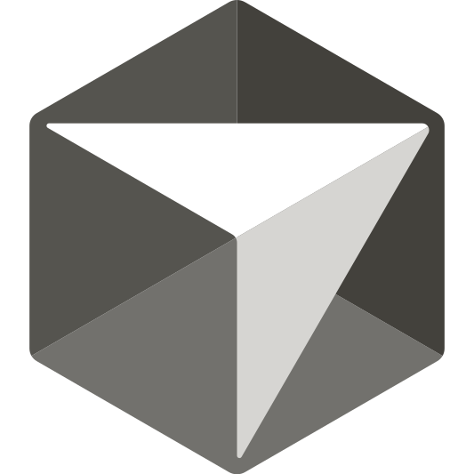
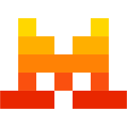

  
  

<b>开源 AI 制作工作室。</b> 聊着天，就能做出完整的电影、剧集、有声书、音乐视频、纪录片、短剧等等。

  
  
  
  
  
  
  
  
  
  

  <a href="../../README.md">English</a> · 中文 · <a href="README.ja.md">日本語</a> · <a href="README.ko.md">한국어</a> · <a href="README.es.md">Español</a> · <a href="README.fr.md">Français</a> · <a href="README.pt.md">Português</a>

  <a href="https://openslop.ai"><b>openslop.ai</b></a>
  &nbsp;·&nbsp;
  <a href="https://app.openslop.ai">app.openslop.ai</a>

  

---

> **私测中。** 目前仅限邀请。
> [在 openslop.ai 加入等候名单](https://openslop.ai)，或者[使用本地模式](local-mode.zh-CN.md)，今天就在自己的电脑上运行。

## 概览

OpenSlop 把你喜欢的 AI 工具串成一条工作流，几分钟就能做出好看的视频，不用再在十个标签页之间来回跳。你带上自己的 AI 账号，OpenSlop 带上工作流。就这么简单。

它在浏览器里运行，什么都不用装。开源，永久免费。由来自 Meta、Google、Stripe 和 Dropbox 的工程师打造。

## 快速开始

OpenSlop 有两种用法：

- **在线**：打开 [app.openslop.ai](https://app.openslop.ai)，无需安装。目前仅限邀请，请先[加入等候名单](https://openslop.ai)。
- **本地模式**：在你自己的电脑上运行。[查看设置指南 →](local-mode.zh-CN.md)

要改代码？按 [CONTRIBUTING.md](../../CONTRIBUTING.md#setup) 搭建开发环境。

## 功能

<table>
<tr>
<td width="50%" valign="middle">

### 描述你的视频

打一行字。选 16:9 或 9:16、一种语言、一个模型和一个时长，或者直接粘贴你已有的脚本。没头绪的话，还有七个模板可以帮你起步。

[编辑器 →](../../app/components/copilot/composer-copilot.tsx)

</td>
<td width="50%">
  
</td>
</tr>
<tr>
<td width="50%" valign="middle">

### Sloppy 和你一起写

副驾驶住在左侧面板里。它读脚本，列出故事大纲，写出场景，再把视频卡片对到台词上。它做的每一步都会在你眼前落到画布上。

[一轮对话是怎么进行的 →](../../ARCHITECTURE.md#sloppy)

</td>
<td width="50%">
  
</td>
</tr>
<tr>
<td width="50%" valign="middle">

### 是分镜板，不是提示框

每个场景是一叠卡片：语音、图片、视频、音效、音乐。改任意一条提示词，为每张卡片单独选模型，拖动排序，鼠标停在哪里就能在哪里插入。

[文档模型 →](../../lib/canvas)

</td>
<td width="50%">
  
</td>
</tr>
<tr>
<td width="50%" valign="middle">

### 一键生成全部

Generate all（全部生成）会把每个元素排进队列，并先处理依赖：先出一个场景所接续的视频卡片再出该场景，先出头像再出它所在的图片。之后改了提示词，卡片会标上 **Stale**（已过期）并说明原因。

[生成图 →](../../ARCHITECTURE.md#canvas-and-generation)

</td>
<td width="50%">
  
</td>
</tr>
<tr>
<td width="50%" valign="middle">

### 播放器和时间线

一边生成一边看成片，字幕逐词显示。下面四条轨道：画面、人声、音效、音乐。拖动标尺，按场景跳转，或者切到分镜条。

[播放器 →](../../app/components/player)

</td>
<td width="50%">
  
</td>
</tr>
<tr>
<td width="50%" valign="middle">

### 带上你自己的密钥

托管模型随账号附带。粘贴一个 Anthropic、Runware、Cartesia 或 ElevenLabs 的密钥，它们的模型就会出现在每个选择器里。密钥存放在 Supabase Vault 中，永远不会到达浏览器。

[模型和提供商密钥 →](../../ARCHITECTURE.md#models-and-keys)

</td>
<td width="50%">
  
</td>
</tr>
<tr>
<td width="50%" valign="middle">

### 在自己的电脑上运行

在你自己的 Mac、Windows 或 Linux 电脑上运行 OpenSlop。项目和视频都留在你手里。

[本地模式 →](local-mode.zh-CN.md)

</td>
<td width="50%">
  
</td>
</tr>
</table>

**盒子里还有：**

- **[字幕](../../app/components/canvas/panel/captions-panel.tsx)** — 六种预设、十二种字体、逐词或逐行显示，每种颜色、描边和位置都随你改。
- **[导出最高 4K](../../app/components/player/export-button.tsx)** — 在 Remotion Lambda 上分块并行渲染，交给你一个 MP4。
- **[版本历史](../../app/components/canvas/panel/canvas-history-panel.tsx)** — 边做边自动保存，合并成检查点。查看任意版本并恢复。
- **[角色和画风](../../app/components/canvas/elements/asset-strip.tsx)** — 给角色起一次名，每张图片、每句配音和每个头像都保持一致。
- **[模板](../../lib/templates/templates.ts)** — POV Life、Sleep Story、True Crime 等等。每个模板都预设了一种风格、一组角色和一个时长。
- **[开发用的 mock](../../.env.example)** — 不填某个提供商的密钥，它的调用就会回退到预置结果，让你不花钱也能开发。

## 支持的智能体

用你自己的编程智能体在 OpenSlop 里免费做视频，可以在线用 [app.openslop.ai](https://app.openslop.ai)，也可以[在你自己的电脑上](local-mode.zh-CN.md)运行。[如何连接](../agents.md)

&nbsp;[Amp](https://ampcode.com/) &nbsp;·&nbsp; &nbsp;[Antigravity CLI](https://antigravity.google/) &nbsp;·&nbsp; &nbsp;[ChatGPT](https://chatgpt.com/) &nbsp;·&nbsp; &nbsp;[Claude Code](https://claude.com/product/claude-code) &nbsp;·&nbsp; &nbsp;[Claude Desktop](https://claude.ai/download) &nbsp;·&nbsp; &nbsp;[Codex](https://openai.com/codex) &nbsp;·&nbsp; &nbsp;[Cursor](https://cursor.com/cli) &nbsp;·&nbsp; &nbsp;[Devin](https://devin.ai/cli) &nbsp;·&nbsp; &nbsp;[Droid](https://www.factory.ai/) &nbsp;·&nbsp; &nbsp;[fx](https://fx.sh/) &nbsp;·&nbsp; &nbsp;[Gemini CLI](https://github.com/google-gemini/gemini-cli) &nbsp;·&nbsp; &nbsp;[GitHub Copilot](https://github.com/features/copilot) &nbsp;·&nbsp; &nbsp;[Grok](https://x.ai/) &nbsp;·&nbsp; &nbsp;[Hermes](https://github.com/NousResearch/hermes-agent) &nbsp;·&nbsp; &nbsp;[Kimi Code](https://www.kimi.com/) &nbsp;·&nbsp; &nbsp;[Kiro](https://kiro.dev/cli/) &nbsp;·&nbsp; &nbsp;[Mastra Code](https://mastra.ai/) &nbsp;·&nbsp; &nbsp;[Mistral Vibe](https://mistral.ai/) &nbsp;·&nbsp; &nbsp;[Muse Code](https://developer.meta.com/ai/products/muse-code/) &nbsp;·&nbsp; &nbsp;[Oh My Pi](https://github.com/can1357/oh-my-pi) &nbsp;·&nbsp; &nbsp;[OpenCode](https://opencode.ai/) &nbsp;·&nbsp; &nbsp;[Pi](https://github.com/badlogic/pi-mono/tree/main/packages/coding-agent) &nbsp;·&nbsp; &nbsp;[VS Code](https://code.visualstudio.com/) &nbsp;·&nbsp; &nbsp;[Windsurf](https://windsurf.com/) &nbsp;·&nbsp; &nbsp;[Zed](https://zed.dev/)

## 技术栈

| 层级          | 技术                                                                                                         |
| ------------- | ------------------------------------------------------------------------------------------------------------ |
| 框架          | [Next.js 16](https://nextjs.org)（App Router）                                                               |
| 语言          | [TypeScript 5](https://www.typescriptlang.org)                                                               |
| UI            | [React 19](https://react.dev)、[Tailwind CSS 4](https://tailwindcss.com)、[shadcn/ui](https://ui.shadcn.com) |
| 认证 + 数据库 | [Supabase](https://supabase.com)（Auth、Postgres、RLS）                                                      |
| 视频          | [Remotion 4](https://remotion.dev)（合成、渲染、播放器）                                                     |
| 存储          | [Vercel Blob](https://vercel.com/docs/storage/vercel-blob)（生成资源的存储）                                 |
| 图标          | 自研的遮罩 SVG 图标集（`components/ui/icon.tsx` + `components/ui/icons/`），无图标依赖                       |

## 项目结构

代码怎么组织、各层如何配合，见 [`ARCHITECTURE.md`](../../ARCHITECTURE.md#project-structure)。

## 脚本

| 命令                      | 作用                               |
| ------------------------- | ---------------------------------- |
| `npm run dev`             | 启动开发服务器                     |
| `npm run local`           | 以本地模式运行                     |
| `npm run build`           | 生产构建                           |
| `npm run lint`            | ESLint                             |
| `npm run format:check`    | Prettier 检查                      |
| `npm run typecheck`       | TypeScript 检查                    |
| `npm run knip`            | 死代码检查                         |
| `npm run test:run`        | 跑一次测试（Vitest）               |
| `npm run test:e2e`        | 冒烟测试（Playwright）             |
| `npm run db:push`         | 把迁移推送到已关联的 Supabase 项目 |
| `npm run remotion:studio` | 打开 Remotion Studio               |

<strong>常见问题</strong>

 

OpenSlop 免费吗？

 

是的。它以 [Apache 2.0 许可证](../../LICENSE)开源。在线版的托管模型随账户提供，本地模式用你自己的 AI 密钥。

需要邀请吗？

 

只有在线版需要。[本地模式](local-mode.zh-CN.md)现在就能在你自己的 Mac、Windows 或 Linux 上运行。

能用哪些 AI 模型？

 

图片和视频来自 Runware，语音来自 Cartesia，音乐和音效来自 ElevenLabs，写作用 Anthropic 的 Claude。每张卡片都能选模型。

能用我已有的剧本吗？

 

能。把它粘贴到输入框里，代替一句话的创意。

项目和视频存在哪里？

 

在线版存在你账户的云端，本地模式存在你的电脑上，只有发给 AI 服务的请求会联网。

怎么拿到成片？

 

点击 **Export**，导出最高 4K 的 MP4。在线版在云端渲染，本地模式在你的电脑上渲染。

生成后改了提示词会怎样？

 

卡片会显示 **Stale** 和原因，你就知道该重新生成什么。

去哪里求助？

 

在 [Discord](https://discord.gg/zeP5482ced) 提问，或发邮件到 [hi@openslop.ai](mailto:hi@openslop.ai)。

## 参与贡献

欢迎贡献。安装步骤、检查顺序，以及我们在 PR 里看重什么，见 [`CONTRIBUTING.md`](../../CONTRIBUTING.md)。

## 社区

  

有问题、有想法，或者只是想来聊聊？[加入我们的 Discord](https://discord.gg/zeP5482ced) 或[给我们发邮件](mailto:hi@openslop.ai)。

社区里的每个人都应遵守我们的[行为准则](../../CODE_OF_CONDUCT.md)。如需举报问题，请发邮件到 [hi@openslop.ai](mailto:hi@openslop.ai)。

## Star 历史

  
  

## 许可证

采用 [Apache 许可证 2.0](../../LICENSE) 授权。
