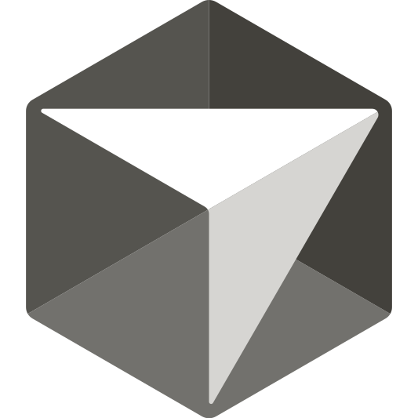

<p align="center">
  <sub><a href="../local-mode.md">English</a> · <a href="local-mode.zh-CN.md">中文</a> · <a href="local-mode.ja.md">日本語</a> · <a href="local-mode.ko.md">한국어</a> · Español · <a href="local-mode.fr.md">Français</a> · <a href="local-mode.pt.md">Português</a></sub>
</p>

# Modo local

<p>
  
  
  
</p>

Tus proyectos y vídeos se quedan en tu ordenador. Solo tus peticiones a los servicios de IA salen a internet.

<p align="center">
  
</p>

## Qué necesitas

| Tu ordenador           | Node.js 22+ | Docker Desktop              |
| ---------------------- | ----------- | --------------------------- |
| Mac con M1 o más nuevo | ✅          | —                           |
| Mac con Intel          | ✅          | ✅ abierto mientras lo usas |
| Windows 10 u 11        | ✅          | ✅ abierto mientras lo usas |
| Linux (x64 o arm64)    | ✅          | —                           |

También necesitas la clave de al menos un proveedor de IA. El paso 5 te dice cuáles.

## Instalación

<table>
<tr>
<td width="50%" valign="middle">

#### 1. Instala Node.js

Ve a la [página de descarga de Node.js](https://nodejs.org/en/download). Haz clic en el botón verde del instalador (**Windows Installer** o **macOS Installer**), abre el archivo y sigue los pasos. Sirve cualquier versión desde la 22.

</td>
<td width="50%">
  
  
</td>
</tr>
<tr>
<td width="50%" valign="middle">

#### 2. Instala Docker Desktop (solo Windows y Mac con Intel)

_Sáltate este paso en Linux o en un Mac con chip M1 o más nuevo (M2, M3, etc.). Para ver el de tu Mac, abre el menú Apple > **Acerca de este Mac** y mira **Chip**._

En [docker.com](https://www.docker.com/products/docker-desktop/), haz clic en **Download Docker Desktop**, elige tu ordenador e instálalo. Ábrelo y déjalo abierto mientras usas OpenSlop.

</td>
<td width="50%">
  
  
</td>
</tr>
<tr>
<td width="50%" valign="middle">

#### 3. Descarga OpenSlop

En la [página de OpenSlop en GitHub](https://github.com/openslop/openslop), haz clic en el botón verde **Code** y luego en **Download ZIP**. También puedes [descargar el ZIP directamente](https://github.com/openslop/openslop/archive/refs/heads/master.zip).

</td>
<td width="50%">
  
  
</td>
</tr>
<tr>
<td width="50%" valign="middle">

#### 4. Descomprímelo y arranca OpenSlop

En Windows, clic derecho en el ZIP > **Extract All**, y luego clic derecho en la carpeta nueva > **Open in Terminal**. En Mac, haz doble clic en el ZIP y luego clic derecho en la carpeta nueva > **New Terminal at Folder**. En el terminal, ejecuta:

```bash
npm install
npm run local
```

La primera vez tarda unos minutos. Después OpenSlop se abre en tu navegador, con la sesión ya iniciada. Para pararlo, pulsa Ctrl+C en el terminal. Tus proyectos se guardan para la próxima vez.

</td>
<td width="50%">
  
  
</td>
</tr>
<tr>
<td width="50%" valign="middle">

#### 5. Añade tus claves de IA

Haz clic en tu icono de perfil, luego en **Settings** > **Add providers**, y conecta un proveedor con tu clave. Las claves que necesitas dependen de lo que hagas:

- **Todo:** los 7 tipos: Text, Speech, Images, Videos, Music, Sound y Captions.
- **Vídeos con voz en off sin cara:** Text, Speech e Images.
- **Vídeos cinematográficos:** Text y Videos.

</td>
<td width="50%">
  
  
</td>
</tr>
</table>

## Agentes compatibles

Usa tu propio agente de programación para crear vídeos en OpenSlop gratis, en tu propia computadora: agrega `http://localhost:3000/api/mcp` como servidor MCP. [Cómo conectarlo](../agents.md).

&nbsp;[Amp](https://ampcode.com/) &nbsp;·&nbsp; &nbsp;[Antigravity CLI](https://antigravity.google/) &nbsp;·&nbsp; &nbsp;[Claude Code](https://claude.com/product/claude-code) &nbsp;·&nbsp; <picture><source media="(prefers-color-scheme: dark)" srcset="../../assets/agents/codex-white.svg" /></picture>&nbsp;[Codex](https://openai.com/codex) &nbsp;·&nbsp; &nbsp;[Cursor](https://cursor.com/cli) &nbsp;·&nbsp; <picture><source media="(prefers-color-scheme: dark)" srcset="../../assets/agents/droid-white.svg" /></picture>&nbsp;[Droid](https://www.factory.ai/) &nbsp;·&nbsp; <picture><source media="(prefers-color-scheme: dark)" srcset="../../assets/agents/fx-white.svg" /></picture>&nbsp;[fx](https://fx.sh/) &nbsp;·&nbsp; &nbsp;[Gemini CLI](https://github.com/google-gemini/gemini-cli) &nbsp;·&nbsp; <picture><source media="(prefers-color-scheme: dark)" srcset="../../assets/agents/copilot-white.svg" /></picture>&nbsp;[GitHub Copilot](https://github.com/features/copilot) &nbsp;·&nbsp; <picture><source media="(prefers-color-scheme: dark)" srcset="../../assets/agents/grok-white.svg" /></picture>&nbsp;[Grok](https://x.ai/) &nbsp;·&nbsp; <picture><source media="(prefers-color-scheme: dark)" srcset="../../assets/agents/hermes-white.svg" /></picture>&nbsp;[Hermes](https://github.com/NousResearch/hermes-agent) &nbsp;·&nbsp; <picture><source media="(prefers-color-scheme: dark)" srcset="../../assets/agents/kimi-white.svg" /></picture>&nbsp;[Kimi Code](https://www.kimi.com/) &nbsp;·&nbsp; &nbsp;[Kiro](https://kiro.dev/cli/) &nbsp;·&nbsp; <picture><source media="(prefers-color-scheme: dark)" srcset="../../assets/agents/mastracode-white.svg" /></picture>&nbsp;[Mastra Code](https://mastra.ai/) &nbsp;·&nbsp; &nbsp;[Mistral Vibe](https://mistral.ai/) &nbsp;·&nbsp; <picture><source media="(prefers-color-scheme: dark)" srcset="../../assets/agents/muse-white.svg" /></picture>&nbsp;[Muse Code](https://developer.meta.com/ai/products/muse-code/) &nbsp;·&nbsp; <picture><source media="(prefers-color-scheme: dark)" srcset="../../assets/agents/pi-white.svg" /></picture>&nbsp;[Oh My Pi](https://github.com/can1357/oh-my-pi) &nbsp;·&nbsp; <picture><source media="(prefers-color-scheme: dark)" srcset="../../assets/agents/opencode-white.svg" /></picture>&nbsp;[OpenCode](https://opencode.ai/) &nbsp;·&nbsp; <picture><source media="(prefers-color-scheme: dark)" srcset="../../assets/agents/pi-white.svg" /></picture>&nbsp;[Pi](https://github.com/badlogic/pi-mono/tree/main/packages/coding-agent)

## El día a día

| Para                    | Haz esto                                                             |
| ----------------------- | -------------------------------------------------------------------- |
| Arrancar OpenSlop       | Abre un terminal en la carpeta de OpenSlop y ejecuta `npm run local` |
| Parar OpenSlop          | Pulsa <kbd>Ctrl</kbd>+<kbd>C</kbd> en ese terminal                   |
| Seguir donde lo dejaste | Vuelve a ejecutar `npm run local`. Tus proyectos y claves siguen ahí |

## Modo local frente a en línea

|                    | Modo local                                       | En línea en [app.openslop.ai](https://app.openslop.ai)                    |
| ------------------ | ------------------------------------------------ | ------------------------------------------------------------------------- |
| Quién puede usarlo | Cualquiera, hoy                                  | Solo con invitación, [apúntate a la lista de espera](https://openslop.ai) |
| Instalación        | Node.js, y Docker Desktop en algunos ordenadores | Nada                                                                      |
| Inicio de sesión   | Automático, un solo usuario                      | Tu cuenta                                                                 |
| Proyectos y medios | En tu ordenador                                  | En la nube                                                                |
| Modelos de IA      | Tus propias claves                               | Modelos incluidos, más tus propias claves                                 |
| Exportar vídeo     | Se renderiza en tu ordenador                     | Se renderiza en la nube                                                   |

## Si algo falla

| El terminal dice                                              | Haz esto                                                                                                   |
| ------------------------------------------------------------- | ---------------------------------------------------------------------------------------------------------- |
| `OpenSlop needs Node.js 22 or newer`                          | Instala Node.js 22 o más nuevo desde el paso 1, abre un terminal nuevo y vuelve a ejecutar `npm run local` |
| `` `npx supabase start …` failed `` (Windows o Mac con Intel) | Abre Docker Desktop, espera a que el motor esté en marcha y vuelve a ejecutar `npm run local`              |
| Cualquier otra cosa                                           | Pregunta en [Discord](https://discord.gg/zeP5482ced) con lo que muestra el terminal                        |

<details>
<summary>Qué se descarga</summary>

- `npm install` descarga el código de la app.
- El primer `npm run local` también descarga, una sola vez:
  - **Supabase**: la base de datos y el almacenamiento de archivos, guardados en `~/.supabase/cache`. En Windows y en Mac con Intel, se guarda dentro de Docker Desktop.
  - **Chrome Headless Shell**: convierte tu proyecto en un archivo de vídeo. Se guarda en `node_modules/.remotion`.

</details>

> ¿Vas a programar en OpenSlop? Para desarrollar con servicios alojados, mira [Desarrollar con un proyecto de Supabase](../../CONTRIBUTING.md#develop-against-a-supabase-project).
