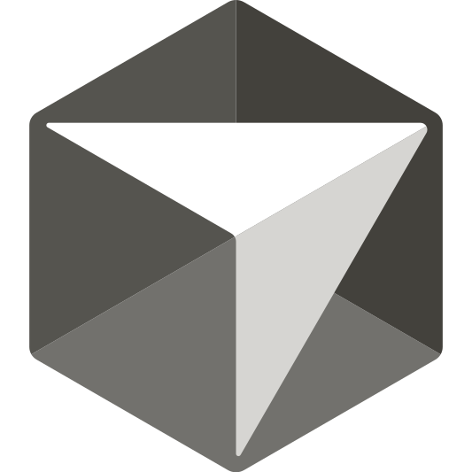

<p align="center">
  <sub><a href="../local-mode.md">English</a> · <a href="local-mode.zh-CN.md">中文</a> · <a href="local-mode.ja.md">日本語</a> · <a href="local-mode.ko.md">한국어</a> · <a href="local-mode.es.md">Español</a> · Français · <a href="local-mode.pt.md">Português</a></sub>
</p>

# Mode local

<p>
  
  
  
</p>

Vos projets et vos vidéos restent sur votre ordinateur. Seules vos demandes aux services d'IA passent par Internet.

<p align="center">
  
</p>

## Ce qu'il vous faut

| Votre ordinateur           | Node.js 22+ | Docker Desktop                  |
| -------------------------- | ----------- | ------------------------------- |
| Mac avec M1 ou plus récent | ✅          | —                               |
| Mac avec Intel             | ✅          | ✅ ouvert pendant l'utilisation |
| Windows 10 ou 11           | ✅          | ✅ ouvert pendant l'utilisation |
| Linux (x64 ou arm64)       | ✅          | —                               |

Il vous faut aussi la clé d'au moins un fournisseur d'IA. L'étape 5 indique lesquelles.

## Installation

<table>
<tr>
<td width="50%" valign="middle">

#### 1. Installez Node.js

Allez sur la [page de téléchargement de Node.js](https://nodejs.org/en/download). Cliquez sur le bouton vert de l'installateur (**Windows Installer** ou **macOS Installer**), ouvrez le fichier et suivez les étapes. Toute version à partir de la 22 convient.

</td>
<td width="50%">
  
  
</td>
</tr>
<tr>
<td width="50%" valign="middle">

#### 2. Installez Docker Desktop (Windows et Mac Intel uniquement)

_Passez cette étape sous Linux ou sur un Mac avec une puce M1 ou plus récente (M2, M3, etc.). Pour vérifier, ouvrez le menu Apple > **À propos de ce Mac** et regardez **Puce**._

Sur [docker.com](https://www.docker.com/products/docker-desktop/), cliquez sur **Download Docker Desktop**, choisissez votre ordinateur et installez-le. Ouvrez-le et laissez-le ouvert pendant que vous utilisez OpenSlop.

</td>
<td width="50%">
  
  
</td>
</tr>
<tr>
<td width="50%" valign="middle">

#### 3. Téléchargez OpenSlop

Sur la [page GitHub d'OpenSlop](https://github.com/openslop/openslop), cliquez sur le bouton vert **Code**, puis sur **Download ZIP**. Vous pouvez aussi [télécharger le ZIP directement](https://github.com/openslop/openslop/archive/refs/heads/master.zip).

</td>
<td width="50%">
  
  
</td>
</tr>
<tr>
<td width="50%" valign="middle">

#### 4. Décompressez-le et lancez OpenSlop

Sous Windows, clic droit sur le ZIP > **Extract All**, puis clic droit sur le nouveau dossier > **Open in Terminal**. Sur Mac, double-cliquez sur le ZIP, puis clic droit sur le nouveau dossier > **New Terminal at Folder**. Dans le terminal, lancez :

```bash
npm install
npm run local
```

Le premier lancement prend quelques minutes. OpenSlop s'ouvre ensuite dans votre navigateur, déjà connecté. Pour l'arrêter, appuyez sur Ctrl+C dans le terminal. Vos projets sont gardés pour la prochaine fois.

</td>
<td width="50%">
  
  
</td>
</tr>
<tr>
<td width="50%" valign="middle">

#### 5. Ajoutez vos clés d'IA

Cliquez sur votre icône de profil, puis sur **Settings** > **Add providers**, et connectez un fournisseur avec votre clé. Les clés nécessaires dépendent de ce que vous créez :

- **Tout :** les 7 types : Text, Speech, Images, Videos, Music, Sound et Captions.
- **Vidéos en voix off sans visage :** Text, Speech et Images.
- **Vidéos cinématiques :** Text et Videos.

</td>
<td width="50%">
  
  
</td>
</tr>
</table>

## Agents pris en charge

Utilisez votre propre agent de code pour créer des vidéos dans OpenSlop gratuitement, sur votre ordinateur : ajoutez `http://localhost:3000/api/mcp` comme serveur MCP. [Comment le connecter](../agents.md).

&nbsp;[Amp](https://ampcode.com/) &nbsp;·&nbsp; &nbsp;[Antigravity CLI](https://antigravity.google/) &nbsp;·&nbsp; &nbsp;[Claude Code](https://claude.com/product/claude-code) &nbsp;·&nbsp; <picture><source media="(prefers-color-scheme: dark)" srcset="../../assets/agents/codex-white.svg" /></picture>&nbsp;[Codex](https://openai.com/codex) &nbsp;·&nbsp; &nbsp;[Cursor](https://cursor.com/cli) &nbsp;·&nbsp; <picture><source media="(prefers-color-scheme: dark)" srcset="../../assets/agents/droid-white.svg" /></picture>&nbsp;[Droid](https://www.factory.ai/) &nbsp;·&nbsp; <picture><source media="(prefers-color-scheme: dark)" srcset="../../assets/agents/fx-white.svg" /></picture>&nbsp;[fx](https://fx.sh/) &nbsp;·&nbsp; &nbsp;[Gemini CLI](https://github.com/google-gemini/gemini-cli) &nbsp;·&nbsp; <picture><source media="(prefers-color-scheme: dark)" srcset="../../assets/agents/copilot-white.svg" /></picture>&nbsp;[GitHub Copilot](https://github.com/features/copilot) &nbsp;·&nbsp; <picture><source media="(prefers-color-scheme: dark)" srcset="../../assets/agents/grok-white.svg" /></picture>&nbsp;[Grok](https://x.ai/) &nbsp;·&nbsp; <picture><source media="(prefers-color-scheme: dark)" srcset="../../assets/agents/hermes-white.svg" /></picture>&nbsp;[Hermes](https://github.com/NousResearch/hermes-agent) &nbsp;·&nbsp; <picture><source media="(prefers-color-scheme: dark)" srcset="../../assets/agents/kimi-white.svg" /></picture>&nbsp;[Kimi Code](https://www.kimi.com/) &nbsp;·&nbsp; &nbsp;[Kiro](https://kiro.dev/cli/) &nbsp;·&nbsp; <picture><source media="(prefers-color-scheme: dark)" srcset="../../assets/agents/mastracode-white.svg" /></picture>&nbsp;[Mastra Code](https://mastra.ai/) &nbsp;·&nbsp; &nbsp;[Mistral Vibe](https://mistral.ai/) &nbsp;·&nbsp; <picture><source media="(prefers-color-scheme: dark)" srcset="../../assets/agents/muse-white.svg" /></picture>&nbsp;[Muse Code](https://developer.meta.com/ai/products/muse-code/) &nbsp;·&nbsp; <picture><source media="(prefers-color-scheme: dark)" srcset="../../assets/agents/pi-white.svg" /></picture>&nbsp;[Oh My Pi](https://github.com/can1357/oh-my-pi) &nbsp;·&nbsp; <picture><source media="(prefers-color-scheme: dark)" srcset="../../assets/agents/opencode-white.svg" /></picture>&nbsp;[OpenCode](https://opencode.ai/) &nbsp;·&nbsp; <picture><source media="(prefers-color-scheme: dark)" srcset="../../assets/agents/pi-white.svg" /></picture>&nbsp;[Pi](https://github.com/badlogic/pi-mono/tree/main/packages/coding-agent) &nbsp;·&nbsp; &nbsp;[VS Code](https://code.visualstudio.com/) &nbsp;·&nbsp; <picture><source media="(prefers-color-scheme: dark)" srcset="../../assets/agents/windsurf-white.svg" /></picture>&nbsp;[Windsurf](https://windsurf.com/) &nbsp;·&nbsp; <picture><source media="(prefers-color-scheme: dark)" srcset="../../assets/agents/zed-white.svg" /></picture>&nbsp;[Zed](https://zed.dev/)

## Au quotidien

| Pour                    | Faites ceci                                                           |
| ----------------------- | --------------------------------------------------------------------- |
| Lancer OpenSlop         | Ouvrez un terminal dans le dossier OpenSlop et lancez `npm run local` |
| Arrêter OpenSlop        | Appuyez sur <kbd>Ctrl</kbd>+<kbd>C</kbd> dans ce terminal             |
| Reprendre votre travail | Relancez `npm run local`. Vos projets et vos clés sont toujours là    |

## Mode local ou en ligne

|                     | Mode local                                          | En ligne sur [app.openslop.ai](https://app.openslop.ai)                      |
| ------------------- | --------------------------------------------------- | ---------------------------------------------------------------------------- |
| Qui peut l'utiliser | Tout le monde, dès aujourd'hui                      | Sur invitation, [inscrivez-vous sur la liste d'attente](https://openslop.ai) |
| Installation        | Node.js, et Docker Desktop sur certains ordinateurs | Rien                                                                         |
| Connexion           | Automatique, un seul utilisateur                    | Votre compte                                                                 |
| Projets et médias   | Sur votre ordinateur                                | Dans le cloud                                                                |
| Modèles d'IA        | Vos propres clés                                    | Modèles hébergés, plus vos propres clés                                      |
| Export vidéo        | Rendu sur votre ordinateur                          | Rendu dans le cloud                                                          |

## En cas de problème

| Le terminal affiche                                             | Faites ceci                                                                                                  |
| --------------------------------------------------------------- | ------------------------------------------------------------------------------------------------------------ |
| `OpenSlop needs Node.js 22 or newer`                            | Installez Node.js 22 ou plus récent depuis l'étape 1, ouvrez un nouveau terminal et relancez `npm run local` |
| `` `npx supabase start …` failed `` (Windows ou Mac avec Intel) | Ouvrez Docker Desktop, attendez que son moteur tourne et relancez `npm run local`                            |
| Autre chose                                                     | Demandez sur [Discord](https://discord.gg/zeP5482ced) avec ce qu'affiche le terminal                         |

<details>
<summary>Ce qui est téléchargé</summary>

- `npm install` récupère le code de l'app.
- Le premier `npm run local` télécharge aussi, une seule fois :
  - **Supabase** : la base de données et le stockage des fichiers, dans `~/.supabase/cache`. Sous Windows et sur Mac Intel, il est stocké dans Docker Desktop.
  - **Chrome Headless Shell** : transforme votre projet en fichier vidéo. Stocké dans `node_modules/.remotion`.

</details>

> Vous codez sur OpenSlop ? Pour développer avec des services hébergés, voir [Développer avec un projet Supabase](../../CONTRIBUTING.md#develop-against-a-supabase-project).
